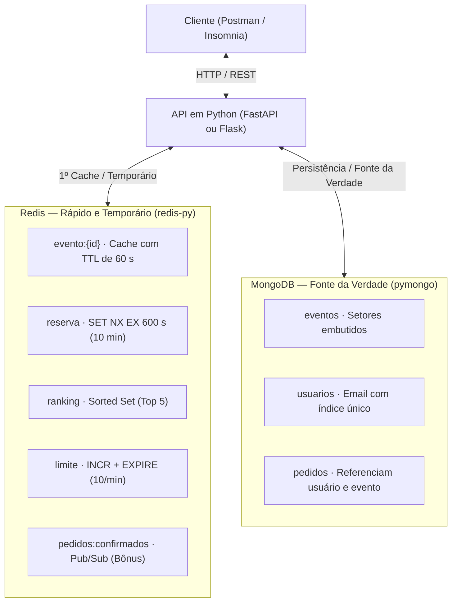

# FIAP — Faculdade de Informática e Administração Paulista

**Curso:** Superior de Tecnologia em Análise e Desenvolvimento de Sistemas  
**Disciplina:** Mastering Relational and Non-Relational Database | **Turma:** 2TDSPG  
**Professor:** Vergílio Santos | **Avaliação:** Checkpoint 3 — Projeto Prático: MongoDB + Redis com Python  

---

## 👥 Integrantes do Grupo (até 5 alunos)

- **RM:** `________` | **Nome:** `________________________________________`
- **RM:** `________` | **Nome:** `________________________________________`
- **RM:** `________` | **Nome:** `________________________________________`
- **RM:** `________` | **Nome:** `________________________________________`
- **RM:** `________` | **Nome:** `________________________________________`

---

## 📋 Instruções de Entrega

Avaliação Prática em grupo. Desenvolvam, em Python, uma aplicação (**API REST**) para a plataforma de ingressos **TicketFlash** que use o **MongoDB** como banco principal e o **Redis** para cache, reservas temporárias, ranking e limite de requisições. A prova vale **10 pontos (+0,5 de bônus)**.

- **Prazo:** 7 dias corridos a partir da publicação.
- **Linguagem:** Python 3.11 ou superior, com **FastAPI** ou **Flask**.
- **Acesso aos bancos:** `pymongo` (ou `motor`) e `redis-py`; dependências listadas em `requirements.txt`.
- **Preenchimento:** Preencha o próprio PDF: RMs e nomes do grupo no topo e os links no campo *Entrega do grupo* ao final.
- **Envio:** Envie na Área de Entrega de Trabalhos do Portal do Aluno um único arquivo compactado (`.zip`) contendo:
  - O PDF preenchido da prova;
  - O código-fonte do projeto (sem as pastas `venv` e `__pycache__`).
- **Execução:** Antes de iniciar, instale o Docker Desktop. O projeto deve subir com um único comando:
  ```bash
  docker compose up
  ```
  contendo três serviços: `api`, `mongo` e `redis`.
- **Regras:** Projetos iguais ou com trechos copiados entre grupos recebem nota zero. O uso de IA é permitido, mas todos os integrantes devem saber explicar o código na apresentação.

---

## 🎟️ Cenário: TicketFlash

A **TicketFlash** vende ingressos para shows e eventos. Em aberturas de vendas, milhares de pessoas acessam a mesma página ao mesmo tempo, e o banco principal não aguenta a carga sozinho. A equipe decidiu dividir as responsabilidades entre dois bancos:

- **MongoDB:** Guarda os dados permanentes: eventos, usuários e pedidos. Os eventos têm estruturas diferentes entre si (setores, atrações, local), o que favorece documentos flexíveis.
- **Redis:** Guarda os dados rápidos e temporários: cache das consultas, reservas que expiram, ranking dos eventos mais vistos e controle de acessos.

O grupo deve implementar o back-end dessa plataforma como uma **API REST em Python**. Não é necessário front-end.

---

## 🏛️ Arquitetura da Solução



---

## 🍃 Parte 1 — MongoDB (4,0 pontos)

O MongoDB é a fonte da verdade: todo dado que precisa sobreviver a uma reinicialização fica nele.

### Requisito 1 — Modelagem (1,0 ponto)
- **Conteúdo:** Documentos, subdocumentos, arrays e referências entre coleções.
- **Descrição:** Crie as coleções abaixo e justifique no `README` cada escolha entre embutir e referenciar.

| Coleção | Campos mínimos | Observação |
| :--- | :--- | :--- |
| `eventos` | `nome`, `categoria`, `data`, `local` (objeto com cidade e endereço), `atrações` (array), `setores` (array com nome, preço, capacidade, vendidos) | Setores ficam embutidos no evento |
| `usuarios` | `nome`, `email` (único), `cidade`, `dataCadastro` | — |
| `pedidos` | `usuarioId`, `eventoId`, `setor`, `quantidade`, `valorTotal`, `status`, `criadoEm` | Referencia usuário e evento |

> **Seed:** O banco deve ser populado por um script `seed.py` com no mínimo **10 eventos**, **20 usuários** e **50 pedidos**.  
> **O que se avalia:** Coerência entre o modelo e o uso dos dados, e qualidade da justificativa.

---

### Requisito 2 — CRUD de eventos (1,0 ponto)
- **Conteúdo:** `insert_one`, `find`, `update_one` e `delete_one` com pymongo.
- **Descrição:** Implemente endpoints para criar, listar (com filtro por categoria e cidade), buscar por id, atualizar e remover eventos.
- **O que se avalia:** As cinco operações funcionando e os filtros aplicados na consulta ao banco.

---

### Requisito 3 — Índices (0,8 ponto)
- **Conteúdo:** `create_index`, índice único, índice composto e `explain()`.
- **Descrição:** Crie pelo menos três índices:
  1. Um único em `usuarios.email`
  2. Um composto em `eventos` (ex.: `categoria` + `data`)
  3. Um em `pedidos.usuarioId`
- Mostre no `README` a saída de `explain()` de uma consulta que use o índice composto.
- **O que se avalia:** Criação dos índices pelo código e leitura correta do plano (`IXSCAN` em vez de `COLLSCAN`).

---

### Requisito 4 — Agregações (1,2 ponto)
- **Conteúdo:** Pipeline com `$match`, `$group`, `$lookup`, `$unwind`, `$project` e `$sort`.
- **Descrição:** Implemente dois relatórios expostos como endpoints:
  - **Faturamento por evento:** Soma de `valorTotal` dos pedidos confirmados, do maior para o menor, com o nome do evento obtido via `$lookup`.
  - **Ocupação por setor de um evento:** Percentual vendido de cada setor, usando `$unwind` e `$project`.
- **O que se avalia:** Pipelines corretos e resultados calculados no banco, não em laços Python.

---

## ⚡ Parte 2 — Redis (3,5 pontos)

O Redis atende tudo que precisa de resposta em milissegundos ou que expira sozinho. Cada requisito exige uma estrutura de dados diferente.

| Req. | Funcionalidade | Estrutura Redis | Comportamento esperado | Pontos |
| :---: | :--- | :--- | :--- | :---: |
| **5** | Cache de evento | String (JSON) ou Hash | `GET /eventos/{id}` consulta o Redis antes do MongoDB; chave `evento:{id}` com TTL de 60 s | 1,0 |
| **6** | Reserva temporária | String com `SET NX EX` | Ao reservar, o ingresso fica bloqueado por 10 minutos; sem confirmação, a reserva expira sozinha | 1,0 |
| **7** | Ranking dos mais vistos | Sorted Set | Cada consulta a um evento faz `ZINCRBY`; `GET /eventos/ranking` devolve o top 5 | 0,8 |
| **8** | Limite de requisições | String com `INCR` + `EXPIRE` | Máximo de 10 reservas por usuário por minuto; acima disso a API responde `429` | 0,7 |

> **Header / Indicador de Origem:** A resposta de `GET /eventos/{id}` deve indicar a origem do dado (ex.: `"origem": "cache"` ou `"origem": "banco"`), para que a demonstração mostre o cache funcionando.

> **🎁 Bônus (+0,5, nota máxima 10):** Publicar uma mensagem via Pub/Sub no canal `pedidos:confirmados` a cada pedido confirmado, com um script Python assinante que registre a mensagem no console.

---

## 🔄 Parte 3 — Integração (1,5 ponto)

Os dois bancos precisam trabalhar juntos e nunca mostrar dados inconsistentes ao usuário. Toda leitura de evento passa primeiro pelo Redis; só dados permanentes são gravados no MongoDB.

### Requisito 9 — Cache-aside com invalidação (0,8 ponto)
- **Conteúdo:** Padrão cache-aside e consistência entre cache e banco.
- **Descrição:** Ao atualizar ou remover um evento no MongoDB, a chave `evento:{id}` deve ser apagada do Redis. A próxima leitura busca no banco e repopula o cache.
- **O que se avalia:** Invalidação tanto no update quanto no delete.

---

### Requisito 10 — Fluxo de compra (0,7 ponto)
- **Conteúdo:** Operações atômicas (`$inc` condicional) combinadas com chaves temporárias.
- **Fluxo:** O fluxo de compra percorre os dois bancos nesta ordem:
  1. `POST /reservas` verifica o limite (Req. 8), confere no MongoDB se o setor tem vagas e cria a reserva no Redis (Req. 6).
  2. `POST /pedidos/confirmar` verifica se a reserva ainda existe no Redis. Se existir, grava o pedido no MongoDB, incrementa `vendidos` do setor com `$inc` e apaga a reserva.
  3. Se a reserva já expirou, a API responde `410` (Gone) e nada é gravado.
- **Observação Atômica:** O incremento de `vendidos` deve ser atômico e não pode ultrapassar a capacidade do setor (dica: condição no próprio filtro do `update_one`).
- **O que se avalia:** Fluxo completo, checagem de capacidade e tratamento da reserva expirada.

---

## 📦 Entregáveis (1,0 ponto)

> [!WARNING]
> **Sem o `docker-compose.yml` funcionando, a correção não é feita.**

- [ ] Repositório Git público com o código-fonte e commits de todos os integrantes;
- [ ] `docker-compose.yml` e `Dockerfile` da aplicação Python;
- [ ] `requirements.txt` e script `seed.py` que popula o MongoDB;
- [ ] `README` com nomes e RMs, como executar, lista de endpoints, justificativa da modelagem (Req. 1) e saída do `explain()` (Req. 3);
- [ ] Coleção do Postman/Insomnia (ou arquivo `.http`) com todas as requisições;
- [ ] Vídeo de até 5 minutos seguindo o roteiro abaixo.

---

## 🎥 Roteiro do Vídeo (até 5 minutos)

1. Subir o ambiente com `docker compose up`.
2. Chamar `GET /eventos/{id}` duas vezes e mostrar a origem mudando de `banco` para `cache`.
3. Atualizar o evento e mostrar que a leitura seguinte volta ao `banco`.
4. Criar uma reserva, mostrar a chave no Redis com TTL e confirmar o pedido.
5. Tentar confirmar uma reserva expirada e mostrar o erro `410`.
6. Disparar 11 reservas seguidas e mostrar o status `429`.
7. Mostrar o ranking e os dois relatórios de agregação.

---

## 📊 Critérios de Avaliação

Cada requisito é avaliado em três níveis: **completo (100%)**, **parcial (50%)** ou **ausente (0%)**.

| Req. | Critério | Completo (100%) | Parcial (50%) | Ausente (0%) | Pontos |
| :---: | :--- | :--- | :--- | :--- | :---: |
| **1** | Modelagem | Coleções corretas e escolhas justificadas | Coleções corretas sem justificativa | Modelagem relacional forçada ou ausente | 1,0 |
| **2** | CRUD de eventos | 5 operações com filtros | Operações sem filtros ou incompletas | Não funciona | 1,0 |
| **3** | Índices | 3 índices + `explain()` | Índices sem `explain()` | Sem índices | 0,8 |
| **4** | Agregações | 2 relatórios corretos | 1 relatório correto | Nenhum | 1,2 |
| **5** | Cache com TTL | Cache-aside com origem visível | Cache sem TTL | Ausente | 1,0 |
| **6** | Reserva temporária | `SET NX EX` com expiração de 10 min | Reserva sem expiração | Ausente | 1,0 |
| **7** | Ranking | Sorted Set com top 5 | Ranking calculado no MongoDB | Ausente | 0,8 |
| **8** | Limite de requisições | `429` após 10 reservas/min | Contador sem janela de tempo | Ausente | 0,7 |
| **9** | Invalidação do cache | Cache apagado em update e delete | Só em um dos dois | Ausente | 0,8 |
| **10** | Fluxo de compra | Fluxo completo, `$inc` atômico e 410 | Sem checagem de capacidade ou de expiração | Ausente | 0,7 |
| **—** | Entregáveis | Repositório, README e vídeo completos | Algum item faltando | Sem README ou sem vídeo | 1,0 |
| | **Total** | | | | **10,0** |
| **Bônus** | Pub/Sub | Publicador + assinante funcionando | — | — | **+0,5** |

> [!CAUTION]
> Na apresentação, um integrante que não souber explicar a parte do código que lhe for perguntada pode ter a **nota individual reduzida em até 50%**.

---

## 📬 Entrega do Grupo

- **Link do repositório:** `________________________________________`
- **Link do vídeo:** `________________________________________`
- **Observações do grupo (opcional):**  
  `____________________________________________________________________`
